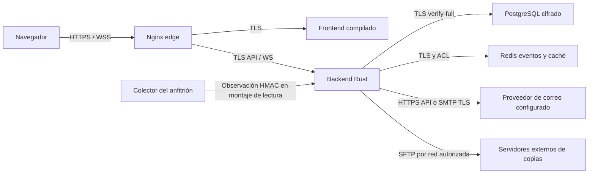

# Despliegue, traslado y publicacion

## Despliegue soportado

Toda reparación se rige por [REPAIR_WORKFLOW.md](REPAIR_WORKFLOW.md) y
[AGENTS.md](../AGENTS.md). No hacer commit/push hasta reconstruir con el script
oficial, comprobar cinco servicios saludables y validar la función modificada
en Docker. Una suite aislada no acredita el despliegue de la instancia principal.

UASSpain se despliega combinando `docker-compose.yml` y
`docker-compose.encrypted.yml` mediante el script de arranque. Este overlay
mantiene obligatorio el cifrado de PostgreSQL, independientemente de BitLocker.
No se soportan Django, `manage.py`, servicios Python ni instalacion nativa.

```powershell
docker compose -f docker-compose.yml -f docker-compose.encrypted.yml config --quiet
powershell -NoProfile -ExecutionPolicy Bypass -File scripts/start-encrypted-stack.ps1 -Build
docker compose -f docker-compose.yml -f docker-compose.encrypted.yml ps
```

Solo Nginx publica `127.0.0.1:80/443`. Compruebe `https://127.0.0.1/healthz` y `https://127.0.0.1/readyz`.

## Configuracion externa

Configure `SITE_URL` con el origen HTTPS público definitivo. Compose usa ese
valor tanto en el build del frontend (`VITE_SITE_URL`) como en el backend:
canonical, Open Graph, robots y sitemaps deben coincidir. Cambiarlo exige
reconstruir el frontend. El build descubre las rutas públicas en `App.tsx`;
compruebe su número en cada build, sin fijarlo al de una versión anterior.
El índice `sitemap.xml`
incluye también `sitemap-courses.xml`, actualizado desde los cursos publicados.
Nginx valida la existencia del curso y compone su HTML público con SSI; los
cursos pendientes conservan su página informativa sin indexación y los inexistentes
responden 404. Conserve esta configuración al
poner otro proxy delante; las rutas privadas y el API llevan `noindex`.

Para comprobar el sitio compilado por HTTPS con una CA autorizada:

```powershell
$env:SITE_TEST_URL='https://localhost:8445'
$env:SITE_TEST_CA='.secrets/tls/ca.crt'
node scripts/e2e/verify-public-site.mjs
```

El script comprueba todas las páginas del sitemap, títulos únicos, contenido
sin JavaScript, cursos publicados, 404 y noindex. Requiere una pila ya levantada;
no cambia datos ni omite la verificación TLS.

- SMTP, SFTP y WireGuard: entregue credenciales o claves fuera de Git y montelas desde `.secrets/`.
- TLS: los certificados internos se generan localmente; las claves privadas nunca se versionan.

El acceso se realiza con correo y contraseña y, cuando la política lo exige,
código OTP por el canal centralizado API/SMTP. Google requiere Authorization
Code con PKCE, secreto cifrado, origen confiable, verificación real y vínculo
previo por sub: [guía de activación](google-oauth-operations.md). Un Client ID
por sí solo no permite activar el flujo seguro. Las migraciones históricas y
sus checksums se conservan.

## Videollamadas WebRTC

El navegador intercambia audio y video mediante WebRTC. El backend autoriza cada participante y retransmite la señalización por WebSocket. El instructor puede invitar a todos sus alumnos a una misma sala; al finalizarla se cierran sus invitaciones. Las salas se generan en el servidor y no aceptan nombres enviados por el cliente.

En localhost o una LAN compatible funcionan los candidatos ICE locales. Para alumnos en redes distintas configure un servidor TURN accesible desde esas redes. Guarde un array JSON de `RTCIceServer` en `.secrets/webrtc_ice_servers.json`, con `urls`, `username` y `credential` de su proveedor, y arranque con:

```powershell
docker compose -f docker-compose.yml -f docker-compose.webrtc.yml up -d --wait
```

Utilice credenciales limitadas y rotables. El archivo se monta como secreto y el endpoint autenticado `/api/videollamadas/ice/` entrega la configuración necesaria al navegador. Verifique con dos redes reales que el servidor TURN transmite medios antes de habilitar llamadas por Internet. La prueba local de Chromium usa dispositivos simulados y comprueba bytes de audio y video recibidos entre tres participantes y la liberación de dispositivos al colgar; no acredita esa conectividad externa.

## Exámenes y validación

La migración `0005_exam_attempts.sql` guarda intentos, preguntas y respuestas. `POST /api/examenes/{id}/intentos/` inicia o recupera un intento; `PUT /api/intentos-examen/{id}/` guarda respuestas. El resultado requiere `attempt_id`: el servidor calcula la nota y el tiempo, aplica prerrequisitos y devuelve el mismo resultado ante reintentos. Pasado el plazo de 40 minutos solo puntúa las respuestas guardadas antes de vencer. La modalidad libre conserva su intento sin fecha límite.

La migración histórica `0006_domain_deletion.sql` conserva contratos de borrado
de entidades; no es el procedimiento de baja. La baja actual es **lógica y
reversible**, conserva relaciones e históricos y revoca acceso:
[operación](account-lifecycle-operations.md). Ninguna actualización autoriza
eliminar perfiles reales para validar. Las imágenes fijan versiones/digests en
sus Dockerfiles; compruebe los cinco IDs ejecutados, no sólo tags.

Antes de ejecutar `scripts/e2e/run-e2e.ps1`, instale `npm ci` y `npx playwright install chromium` en `frontend`. El runner recrea exclusivamente el proyecto `uasspain-e2e`, verifica backups/restauraciones locales y SFTP y recorre los tres paneles en Chromium. `-SkipBrowser` omite únicamente el navegador; `-Keep` conserva la pila aislada para investigar un fallo.

## Reconstruccion PostgreSQL desde migraciones

El esquema procede exclusivamente de `backend-rust/migrations/`, ejecutadas
por SQLx en orden con el rol migrador al arrancar el backend. No restaure un
esquema alternativo ni edite checksums de migraciones aplicadas. Para actualizar:
backup cifrado, descifrado y recuperación aislada verificables, expansión
compatible y arranque oficial con `-Build`. Compruebe tablas, filas, claves,
relaciones, privilegios y checksums antes/después, no sólo el número de versión.

La promoción inicial de octubre se conserva como [evidencia histórica](LOCAL_VALIDATION.md).
`tools/postgres-rebuild.mjs` y el overlay de reconstrucción son herramientas
especializadas con supuestos antiguos, incluida una recuperación limitada a un
administrador; **no son un procedimiento general para recuperar esta base con
varios usuarios**. No vuelva a promover el proyecto fechado ni ejecute
`restore-admin` sobre la instalación activa. La recuperación actual completa se
documenta en [backup y restauración](BACKUP_RESTORE.md), con autorización e
integridad comprobadas. Mantenga claves y datos por canales independientes.

TLS PostgreSQL exige `verify-full`, CA y hostname, y rechaza conexiones sin TLS.
Los roles de runtime no tienen privilegios DDL; backup solo lee y SQLx solo
puede ser modificado por el migrador. Los secretos quedan fuera de Git.

PGDATA, WAL, archivos temporales y logs PostgreSQL persisten exclusivamente en
`postgres_ciphertext`, con contenido AES-256-GCM y nombres cifrados. La vista
descifrada es un montaje FUSE dentro del contenedor; el directorio padre y la
entrega de clave usan tmpfs. No se admite un arranque de produccion sin ese
montaje. Se mantiene TLS `verify-full` y el cifrado independiente de campos.

La clave de almacenamiento es aleatoria de 32 bytes y se guarda solo como blob
DPAPI CurrentUser en `.secrets/postgres-storage-key.dpapi`. En una instalacion
nueva sin datos cifrados ni clave, use `-InitializeKey` al primer desbloqueo.
No se sobrescribe una clave existente ni se genera un reemplazo para un volumen
ya cifrado. Se entrega por stdin a tmpfs y se elimina despues del montaje;
nunca se incorpora al entorno, argv, imagen ni log. El usuario Windows debe ser
el propietario del perfil DPAPI; conserve ese perfil y una estrategia de
recuperacion de claves antes de reinstalar o trasladar el equipo.

BitLocker esta desactivado en esta instalacion y no es dependencia de PostgreSQL.
Se configura `%UserProfile%/.wslconfig` con `[wsl2]` y `swap=0`, aplicado tras
reiniciar WSL/Docker Desktop. El gate lee `/proc/swaps` y rechaza la activacion
si queda swap. La desactivacion afecta a la VM WSL 2, no solo a este contenedor.
El cifrado protege los archivos activos de PostgreSQL; no cifra todo Windows
ni acredita borrado forense de bloques historicos del VHDX.

Para el arranque habitual y la verificacion:

```powershell
.\scripts\start-encrypted-stack.ps1
node tools/verify-postgres-storage.mjs uasspain
```

El desbloqueo se requiere tras cada reinicio de PostgreSQL; sin clave no arranca
ni crea un cluster en claro. FUSE necesita `/dev/fuse` y SYS_ADMIN en el arranque,
pero el proceso PostgreSQL pierde esa capacidad y funciona con CapEff cero.
No se usa `privileged`, el socket Docker ni dispositivos de disco del host.
El verificador comprueba montaje, flags criptograficos, cobertura, ausencia de
clave persistente y rechazo de clave incorrecta desde una vista raw sin FUSE.

En Windows se puede instalar la recuperacion automatica para el propietario
de la clave DPAPI existente:

```powershell
.\scripts\install-encrypted-autostart.ps1
```

La tarea usa el token interactivo del mismo usuario, privilegios limitados y
un proceso oculto. No almacena una contraseña Windows ni una clave en claro.
Cada diez segundos comprueba el contenedor existente y solo entrega la clave
si PostgreSQL ya esta iniciado y el volumen cifrado necesita desbloqueo.
Respeta las paradas manuales y no crea claves, volumenes ni contenedores.
Se inicia al entrar en Windows y dispone de un disparador periódico de un minuto
para recuperar el watcher si su proceso termina. `IgnoreNew` evita duplicados
mientras sigue ejecutándose. El disparador tampoco inicia Docker ni contenedores
detenidos. Vuelva a ejecutar el instalador para actualizar una tarea anterior
que solo tuviera el disparador de inicio de sesión.
Requiere la sesion Windows del propietario y Docker disponible; no desbloquea
antes de iniciar esa sesion. El log contiene solo estados operativos en
`.run/uasspain/storage-autounlock.log`. Para desinstalarla, sin detener Docker:

```powershell
.\scripts\install-encrypted-autostart.ps1 -Uninstall
```

El arranque manual sigue disponible. Espera el healthcheck de PostgreSQL tras
entregar la clave, incluso si el contenedor ya estaba marcado `unhealthy`;
Compose solo arranca el resto de la pila cuando la base esta preparada.
Los supervisores `tini` de PostgreSQL, Redis y frontend conservan `CAP_KILL` para reenviar
las señales de apagado a sus procesos con otro UID. Los servidores mantienen
cero capacidades efectivas; PostgreSQL tampoco conserva `SYS_ADMIN`. Esto
permite cerrar la base, persistir el AOF y detener Nginx sin el error fatal
`EPERM` del supervisor.

El volumen cifrado ya promovido está marcado externo para preservarlo. No lo
cambie por el nombre de un ejemplo ni permita dos servidores sobre el mismo
volumen. Las herramientas históricas de activación/archivo no forman parte de
una actualización habitual. Conserve las copias cifradas anteriores y su
recuperación de claves; cualquier restauración requiere autorización, impacto
revisado y ensayo aislado. Nunca reactive una copia en claro ni use `down -v`
sobre la instalación real.

## Traslado de la instalacion

Conserve el repositorio sin `.env` ni `.secrets`, un backup PostgreSQL verificado, los volumenes de media/backups necesarios y los secretos por un canal independiente. No exporte `node_modules`, `target`, caches, artefactos E2E ni `.local-snapshots`.

## Gate previo a GitHub

```powershell
git status --short
git diff --check
docker compose config --services
```

Ejecute los gates de [README.md](../README.md) y [SECURITY.md](../SECURITY.md). No publique mientras Gitleaks sobre el historial no sea 0 o existan credenciales antiguas sin revocar.

No reescriba el remoto ni use force. Si hay divergencia, preserve ambas ramas,
revise los cambios e integre mediante el procedimiento autorizado; no elimine
trabajo remoto para publicar una documentación.

Rollback: restaure refs desde un bundle verificado y el worktree desde su snapshot; cualquier recuperacion remota necesita una nueva autorizacion.

## Mapa técnico de la aplicación

El contrato de rutas está en [app.rs](../backend-rust/src/app.rs); la autoridad
del esquema son [las migraciones SQLx](../backend-rust/migrations). Este mapa
agrupa las APIs sin duplicar cada definición ni inventar una especificación
OpenAPI inexistente. Todas las rutas privadas validan identidad y autorización
en su handler/extractor, no por el prefijo de URL ni por React.



Correo, servidores externos y colector son integraciones externas, no servicios
Docker permanentes adicionales. VPN se gestiona en el anfitrión; una observación
no concede al contenedor administración del sistema operativo.

### Backend, APIs y errores

| Módulos Rust | Contrato y responsabilidad |
|---|---|
| `main`, `app`, `db` | Inicio TLS, router/middleware, pool PostgreSQL, migrador y permisos; tareas de correo, contenido, cuentas y backups. |
| `auth`, `registration`, `security`, `google_oauth`, `google_oidc` | `/api/auth/*`, `/api/system/auth-policy/`, `/api/system/google-oauth/*`; credenciales, sesiones/ventana, cifrado, OTP y OAuth. |
| `users`, `instructors`, `instructor_access`, `academic_scope` | `/api/profiles/*` y recursos de instructor; identidad, roles, asignaciones y alcance. |
| `account_lifecycle`, `student_directory` | `/api/account/deactivate/`, `/api/admin/students/*`; baja, reactivación, histórico, filtros, CSV y contadores. |
| `exams`, `exam_admin`, `exam_import`, `materials`, `material_text` | `/api/examenes/*`, `/api/intentos-examen/*`, materiales/importaciones; intentos, respuestas, notas y texto PDF. |
| `chat`, `connections`, `video` | Chat, conexiones, invitaciones, ICE y `/ws/chat/{room_id}/`, `/ws/videollamada/{id}/`; permisos por participante. |
| `content`, `services`, `seo`, `content_images`, `service_images`, `content_realtime` | `/api/blog/posts`, `/api/courses`, `/api/services`, sus editores admin, SEO y `/ws/public-content/`. |
| `email`, `mail_config`, `mail_provider`, `mail_queue`, `mail_migration`, `contact` | Contacto, `/api/system/mail/*`, transporte exclusivo, secretos cifrados, outbox, reconciliación y evidencias. |
| `backups`, `backup_operations`, `backup_delta`, `backup_artifacts` | `/api/backups/*`; trabajos, inventario, destinos, cadenas, cifrado y recuperación. |
| `infrastructure`, `vpn` | `/api/infrastructure/*`, `/api/vpn/status/`; configuración, adaptadores, evidencias y observación auténtica. |
| `uploads`, `cache`, `dashboard`, `system_status`, `observability`, `error` | Archivos privados, bus Redis, agregados, salud, logs JSON y errores seguros. |

`error.rs` devuelve HTTP, `code`, detalle seguro y `correlation_id`; los errores
de base no exponen consultas ni valores personales. Nginx aplica límites por
ruta y el backend sus controles específicos. No copie cuerpos completos de
autenticación/callback ni secretos al diagnosticar.

### Frontend y estado

`frontend/src/App.tsx` define React Router; `pages/` separa páginas públicas y
paneles. Los paneles cargan secciones bajo demanda; `ProtectedRoute` mejora la
navegación, pero no sustituye permisos Rust. `api/apiClient.ts` centraliza Axios,
cookies, binding de ventana y refresh coordinado; `services/` contiene contratos
del dominio. Contextos/hooks gestionan identidad, cargas y suscripción a eventos;
React Query se utiliza donde el componente lo requiere, no como una base de datos.

`components/ui/` aporta modales, botones y avisos; `components/admin/` comparte
editores y tablas. `lib/infrastructure.ts` traduce estados sin alterar códigos
backend, preserva datos concurrentes y no rellena información desconocida.
`GoogleOAuthCallback` y el handoff retiran el código de la URL antes del arranque.
Tailwind/variables de tema y componentes adaptables conservan claro/oscuro;
Playwright prueba tamaños y teclado concretos. `scripts/prerender.mjs` y
`verify-build.mjs` verifican HTML y assets generados. Los uploads no se sirven
como un directorio público general.

### Modelo de datos, Redis y ficheros

| Entidades PostgreSQL | Relaciones y persistencia |
|---|---|
| `auth_user`, `accounts_userprofile`, `auth_tab_session` | Cuenta, perfil, roles/estado y sesiones por ventana; PII cifrada e índices de búsqueda protegidos. |
| `account_lifecycle*`, `student_membership`, `student_course_registration` | Baja/eventos y pertenencia académica histórica sin depender sólo del rol actual. |
| `examenes_*`, `materiales_*` | Exámenes, preguntas, intentos/resultados, materiales y permisos; no se eliminan por una baja lógica. |
| `conexiones_*` y auditoría | Mensajes, conexiones y actividad; las relaciones exactas están en migraciones, no en nombres inferidos desde la UI. |
| `courses`, publicaciones, `services`, `service_routes`, `content_*` | Oferta pública, slugs, imágenes, revisiones y notificación transaccional de contenidos. |
| `core_systemsetting`, `core_systemsecret`, `mail_*` | Configuración, secretos cifrados, cola y transiciones/evidencia de migración de correo. |
| `backups_*`, `infrastructure_config`, `infrastructure_evidence` | Operaciones, réplicas/configuración y verificaciones; un estado guardado no prueba una conexión actual. |
| `google_oauth_flow`, `google_oauth_event` | Migración aditiva 0030: estado efímero cifrado/consumible y evidencia protegida; conserva identidades anteriores. |

Los nombres con `*` agrupan tablas; consulte SQL para nombres, claves, índices y
constraints exactos. Las tablas Django heredadas no implican un runtime Django.
Runtime, migrador, backup, restauración y monitor tienen identidades separadas;
no conceda DDL a la cuenta de aplicación para evitar un error de migración.

Redis distribuye eventos por Pub/Sub y mantiene caché/conectividad; usa TLS, ACL
y el volumen `redis_data` con AOF configurado. **No es la cola persistente de
correo ni el almacén definitivo de mensajes**: esos datos viven en PostgreSQL.
No se promete recuperación de un evento Pub/Sub perdido como si fuera durable.
Archivos privados viven en media; el frontend conserva assets con hash anteriores
para pestañas abiertas. Backups/claves y ciphertext tienen volúmenes separados.

### Verificación y mantenimiento

Antes de migrar: inspección, backup cifrado/checksum, descifrado y restauración
aislada con comparación. Aplique EXPAND sin editar migraciones anteriores ni
retirar columnas. Tras arranque oficial con `-Build`, compruebe cinco healthy,
cuatro HTTP 200, versión/binario/manifest y función sobre Docker. Una prueba
de aceptación aislada debe identificar que usa las mismas imágenes finales;
no puede presentarse como escritura sobre la instancia real.

Ejecute el target Rust `audit`, tipos/lint/unitarias/build frontend y la suite
E2E pertinente. Las pruebas destructivas/restauraciones sólo usan fixtures.
Los scripts de aceptación adicionales están en `scripts/e2e/` y los escenarios
de navegador en `frontend/e2e/`; el runner general no ejecuta automáticamente
todos los nuevos escenarios especializados. Selecciónelos de forma explícita.
El gate de seguridad es `scripts/verify-production-security.ps1`, con informes
fuera de Git. Publique después de todos los gates, mediante fetch/push normal;
compare SHA y repita salud/función. No borre volúmenes para limpiar pruebas.
